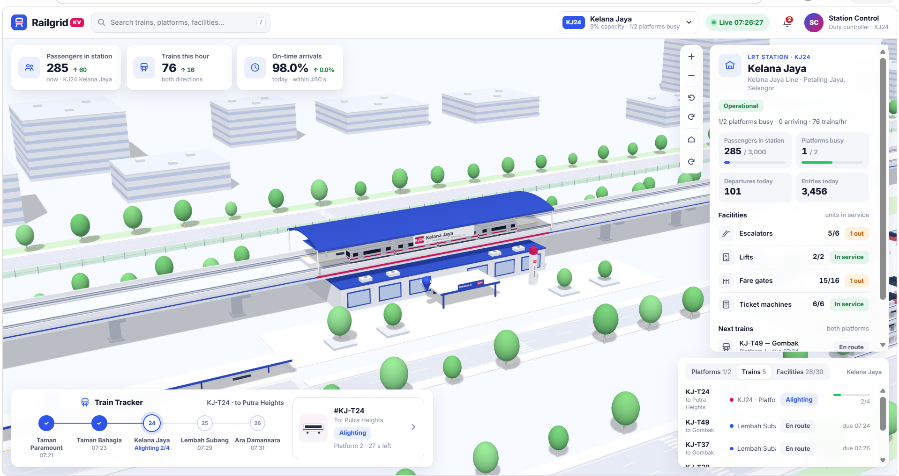

# lrt-3d-simulation

**Railgrid · Kelana Jaya**: an interactive 3D control-room dashboard for **KJ24 Kelana Jaya** LRT station (Kelana Jaya Line, Petaling Jaya, Selangor), built with [Three.js](https://threejs.org/).

It renders the elevated station, viaduct, roads, feeder bus hub and Park & Ride in 3D. Driverless 4-car trains run on both tracks, passengers build up on the platforms, and buses come and go. Live panels show station KPIs, train status, crowding, facilities and alerts.

**Live demo: https://lrt-3d-simulation.vercel.app**



> **All data is simulated.** Nothing is pulled from Rapid KL or any live feed. The timetable, ridership and facility faults are generated in the browser so the demo has something realistic to show.

---

## Contents

- [Features](#features)
- [Quick start](#quick-start)
- [Using the app](#using-the-app)
- [How the simulation works](#how-the-simulation-works)
- [Project structure](#project-structure)
- [Offline use](#offline-use)
- [Deploying](#deploying)
- [Customising](#customising)
- [Troubleshooting](#troubleshooting)
- [Tech stack](#tech-stack)

---

## Features

- **3D station model**: island platform, curved roof, concourse, viaduct with piers and running rails, surrounding roads, bus lay-by and car park. Includes soft shadows, fog and floating labels.
- **Live train simulation**: trains approach, dwell (doors open → boarding → doors closing → depart) and leave on both platforms:
  - Platform 1 → Gombak (northbound)
  - Platform 2 → Putra Heights (southbound)
- **Passenger model**: platform crowding grows and shrinks with a weekday ridership curve, with morning and evening peaks in Malaysia time.
- **KPI bar**: passengers in station, trains this hour, and on-time arrivals (within ±60 s), each with a trend arrow.
- **Details panel**: click anything in the 3D scene (station, platform, train, concourse, bus hub, car park) to see its stats.
- **Train Tracker**: the selected or next train's progress through the neighbouring stations, with ETAs.
- **List view** with tabs for **Platforms**, **Trains** and **Facilities** (escalators, lifts, fare gates, ticket machines).
- **Alerts**: equipment out of service, late arrivals and crowded platforms, shown under the bell icon.
- **Search** across trains, platforms, facilities and buses.
- **Follow mode**: lock the camera onto a moving train.
- **Cinematic orbit**: an automatic slow camera fly-around.
- **Works offline**: Three.js is bundled locally in `vendor/`, so no CDN is needed.

---

## Quick start

The app is a single HTML file, but it **must be served over HTTP**. Browsers block ES-module imports from `file://`, so double-clicking the HTML file shows a blank page.

### Option 1: Python (no install needed if you have Python)

```bash
# 1. Clone the repo
git clone https://github.com/Thilak7c/lrt-3d-simulation.git
cd lrt-3d-simulation

# 2. Start a local web server
python -m http.server 8000
```

Then open **http://localhost:8000/railgrid-kelana-jaya.html** in your browser.

Press `Ctrl+C` in the terminal to stop the server.

### Option 2: Node.js

```bash
npx serve .
```

Open the URL it prints and click `railgrid-kelana-jaya.html`.

### Option 3: VS Code

Install the **Live Server** extension, right-click `railgrid-kelana-jaya.html` and choose **Open with Live Server**.

### Requirements

- A modern browser with **WebGL** and **import maps**: Chrome / Edge 89+, Firefox 108+, Safari 16.4+.
- A GPU that can handle real-time shadows. Any recent laptop is fine.

---

## Using the app

### Camera (3D view)

| Action | Mouse / touch |
|---|---|
| Pan | Left-drag (one-finger drag on touch) |
| Rotate / tilt | Right-drag (two-finger rotate on touch) |
| Zoom | Scroll wheel / pinch |
| Select an object | Click it (the cursor turns into a pointer over clickable things) |

The toolbar on the left side of the map has buttons for: **zoom in / out**, **rotate left / right**, **reset view** and **cinematic orbit**.

When you zoom in close, the station roof fades out so you can see the platform.

### Keyboard shortcuts

| Key | Action |
|---|---|
| `/` | Focus the search box |
| `Enter` (in search) | Jump to the first result |
| `Esc` | Clear search and close any open pop-up |

### Panels

- **Header**
  - **Search**: find trains, platforms, facilities and buses.
  - **Station picker** (`KJ24 Kelana Jaya`): jump to any area of the station.
  - **Live clock**: Malaysia time (MYT).
  - **Alerts bell**: shows a count of active alerts.
- **KPI cards** (top): station-wide numbers that update every frame.
- **Details panel** (right): stats for whatever is selected. Use **✕** to return to the station overview. On a train, the **target** button toggles follow mode.
- **Train Tracker** (bottom): the train's journey through five stations around KJ24.
- **List** (bottom): switch between Platforms, Trains and Facilities. Click a row to select it in 3D.

---

## How the simulation works

Everything runs client-side in `railgrid-kelana-jaya.html`.

- **Time**: the simulation runs at real wall-clock speed, starting when the page loads. Times are shown in Malaysia time (UTC+8), so the demand level depends on your actual time of day.
- **Demand**: a weekday ridership curve (`DEM`) runs from 0 to 1 by hour. It peaks around 07:00–09:30 and 17:00–20:00.
- **Timetable**: a compressed demo headway of **75 s at peak** and **120 s off-peak** (`headway()`). Trains get small random delays, which feed the on-time KPI and late-arrival alerts.
- **Passengers**: people enter at `ENTRY_RATE × demand`, wait on the platform, and board or alight when a train dwells. Crowding thresholds:
  - **Normal** below 120 waiting
  - **Busy** from 120
  - **Crowded** from 260
- **Facilities**: a fixed list of escalators, lifts, fare gates and ticket machines (`FAC`). Fare gate 12 is deliberately faulty to show how alerts look.
- **Randomness**: a seeded RNG (`rng(2024)`) makes the layout and starting state the same on every load.

The code points out where real data could be plugged in. For example, the headway is marked as a shortcut to replace with a real GTFS feed.

---

## Project structure

```
lrt-3d-simulation/
├── railgrid-kelana-jaya.html   # The whole app: HTML, CSS and JS (ES module)
├── vendor/
│   └── three/                  # Local copy of three@0.160.0 (only the files used)
│       ├── build/
│       │   └── three.module.js
│       └── examples/jsm/
│           ├── controls/       # MapControls.js, OrbitControls.js
│           ├── lines/          # LineSegments2.js, LineSegmentsGeometry.js, LineMaterial.js
│           ├── renderers/      # CSS2DRenderer.js
│           └── utils/          # BufferGeometryUtils.js
├── docs/
│   └── screenshot.png          # Screenshot used in this README
├── vercel.json                 # Serves the app at the site root on Vercel
└── README.md
```

### Inside `railgrid-kelana-jaya.html`

The script is split into sections with banner comments (`/* ==== ... ==== */`). In order:

1. **Helpers, time, demand**: formatting, seeded RNG, MYT clock, ridership curve, headway.
2. **Renderer, scene, camera**: WebGL renderer, CSS2D label layer, `MapControls`, lighting and shadows.
3. **Materials & static batching**: static geometry is merged per material (`mergeGeometries`) to keep draw calls low.
4. **World**: ground, roads, bus bays, plaza, viaduct, station, concourse, car park.
5. **Vehicles**: train and bus models.
6. **Simulation**: timetable, train state machine (approach → dwell → depart), passengers, buses.
7. **Selection, picking, camera**: click-to-select, hover, follow mode, camera fly-to.
8. **UI**: the panel, tracker, list, KPIs, alerts, search and event handlers.
9. **Frame loop**: steps the simulation and renders each frame.

---

## Offline use

Three.js is loaded through an import map that points at the local `vendor/` folder:

```html
<script type="importmap">
{"imports":{"three":"./vendor/three/build/three.module.js","three/addons/":"./vendor/three/examples/jsm/"}}
</script>
```

So the app runs with no internet connection, as long as you serve it from a local server (see [Quick start](#quick-start)).

The only online resource left is the **Inter** font from Google Fonts. Offline, the browser falls back to a system font and everything else works the same.

**If you move the HTML file, keep the `vendor/` folder next to it.**

### Upgrading Three.js

Download the same set of files for the new version from `https://cdn.jsdelivr.net/npm/three@<version>/...` into `vendor/three/`.

Check each add-on's own `import` lines, since add-ons can depend on other add-ons. For example, `MapControls.js` needs `OrbitControls.js`.

Newer versions (r171+) also split the core into `three.core.js`, which must be downloaded too.

---

## Deploying

The app is a static site, so any static host works. It is deployed on **Vercel**:

```bash
npm i -g vercel     # once
vercel login        # once
vercel deploy --prod
```

`vercel.json` rewrites `/` to `railgrid-kelana-jaya.html`, so the site root opens the simulation. No build step or framework setting is needed.

---

## Customising

| What | Where (search for it in the HTML) |
|---|---|
| Peak / off-peak headway | `const headway=` |
| Ridership curve by hour | `const DEM=` |
| Passenger entry rate | `const ENTRY_RATE=` |
| Facility list and faults | `const FAC=` |
| Neighbouring stations in the tracker | `const STNS=` |
| Initial camera position | `const HOME=` |
| Colours | `const C=` |

---

## Troubleshooting

| Problem | Fix |
|---|---|
| Blank page / stuck on "Loading…" | You opened the file via `file://`. Serve it with a local server instead (see [Quick start](#quick-start)). |
| Blank page while served | Open DevTools (`F12`) → Console. A 404 on `vendor/...` means the `vendor/` folder is missing or in the wrong place. |
| `Address already in use` | Port 8000 is taken. Use another port: `python -m http.server 8080`. |
| Changes not showing | Hard refresh with `Ctrl+Shift+R`. |
| Low frame rate | Close other GPU-heavy tabs, or make the browser window smaller. The shadow map is 4096², which is the main GPU cost. |
| Font looks different | You're offline, so Inter can't load and a system font is used. This is expected. |

---

## Tech stack

- **[Three.js](https://threejs.org/) r160**: WebGL rendering, `MapControls`, `CSS2DRenderer`, fat lines (`LineSegments2`).
- Plain HTML, CSS and JavaScript (ES modules). No build step, no framework, no `npm install`.
- **Inter** typeface (Google Fonts, optional).
